# PASTRAMI IQ — AI Advertising Studio, Baghdad

**One idea. No noise.** We write the idea first, then make it with AI. Each frame carries one thought your audience gets in a second.

Contact: Instagram **[@pastrami_iq](https://www.instagram.com/pastrami_iq/)** · message the word **CONCEPT** with one line about your brief.

All work below is self-initiated concept work for unbranded products, labelled as AI-generated. Tap any preview to open the full video.

---

## Espresso & coffee

| Free of Noise | Tsunami in a Cup |
|:---:|:---:|
| [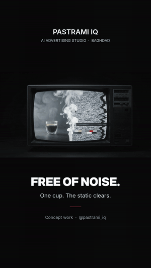](https://raw.githubusercontent.com/rabeea-global/pastrami-media/main/showcase/reel_free_of_noise.mp4) | [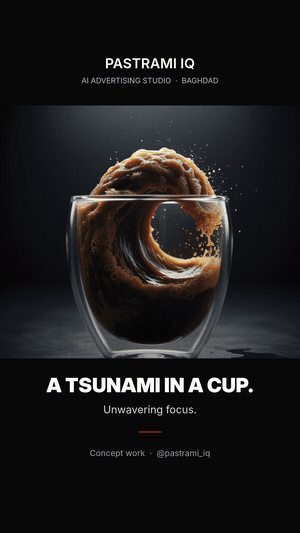](https://raw.githubusercontent.com/rabeea-global/pastrami-media/main/showcase/reel_13.mp4) |
| *A Monday head is static on every channel. Steam splits the screen; the noise breaks, the cup stays.* | *A strong shot hits like a wave. The espresso rises out of its glass and breaks.* |

## Sweets — "The Formula of Flavor" (3-slide series)

| Banana chocolate | Mocha | Apple pie |
|:---:|:---:|:---:|
| 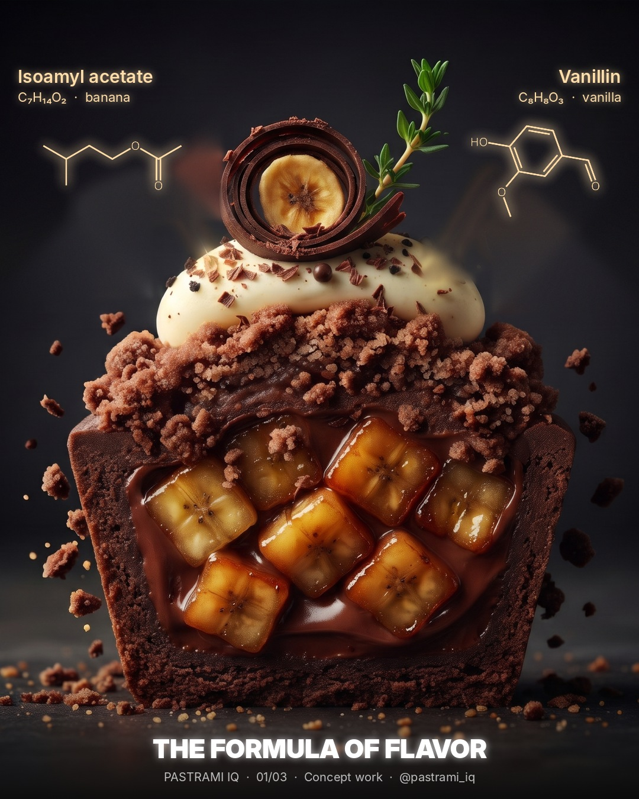 | 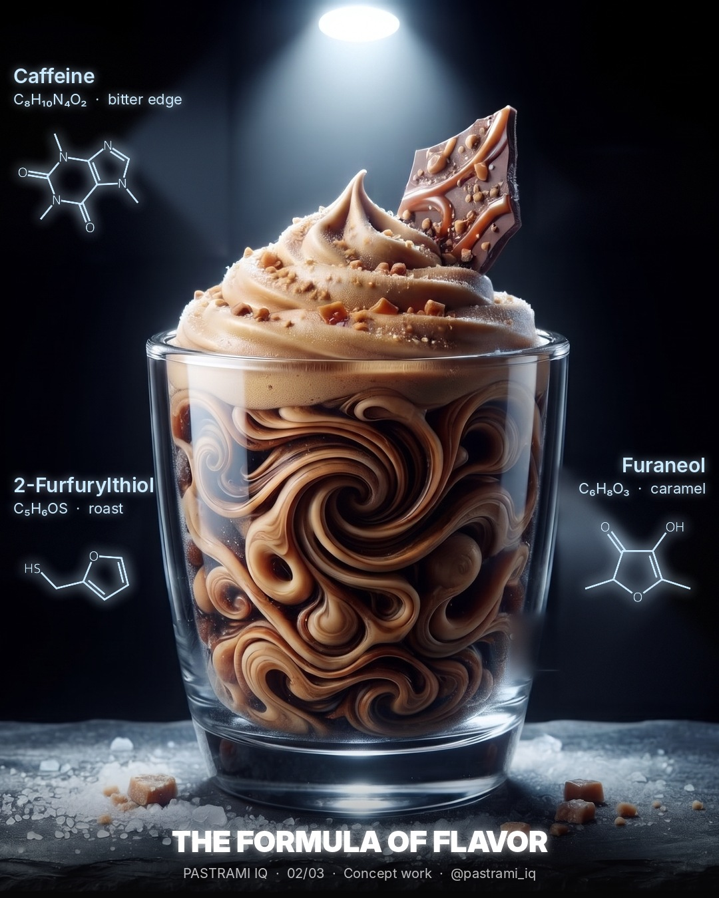 | 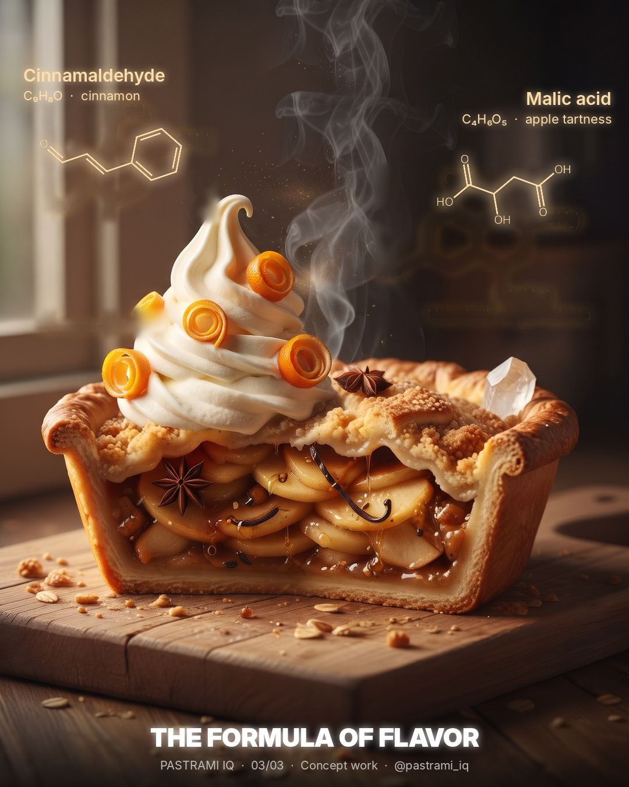 |

*Every craving has a molecule behind it. Image models draw convincing chemistry that is wrong; every structure here was replaced with an accurate one.*

## Fast food

| Can't Resist | Protect & Serve | It Resonates |
|:---:|:---:|:---:|
| [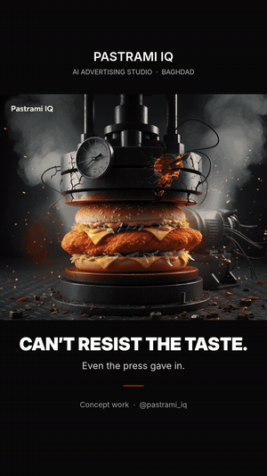](https://raw.githubusercontent.com/rabeea-global/pastrami-media/main/showcase/reel_09.mp4) | [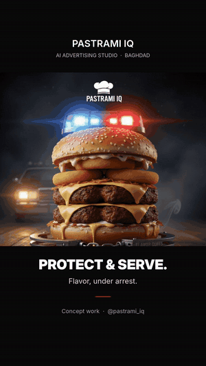](https://raw.githubusercontent.com/rabeea-global/pastrami-media/main/showcase/reel_17.mp4) | [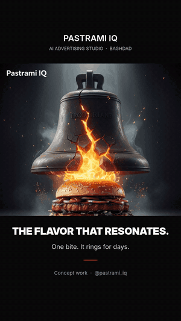](https://raw.githubusercontent.com/rabeea-global/pastrami-media/main/showcase/reel_16.mp4) |
| *A 50-ton press cracks before the sandwich does.* | *Flavor, under arrest.* | *One bite. It rings for days.* |

| The Knockout Bite | Finest Details | Flavor Hatched |
|:---:|:---:|:---:|
| [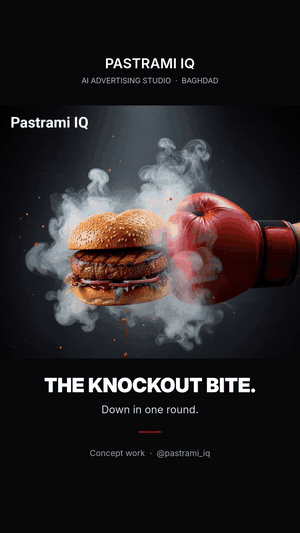](https://raw.githubusercontent.com/rabeea-global/pastrami-media/main/showcase/reel_11.mp4) | [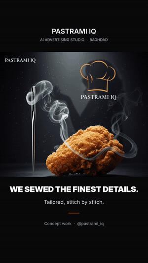](https://raw.githubusercontent.com/rabeea-global/pastrami-media/main/showcase/reel_15.mp4) | 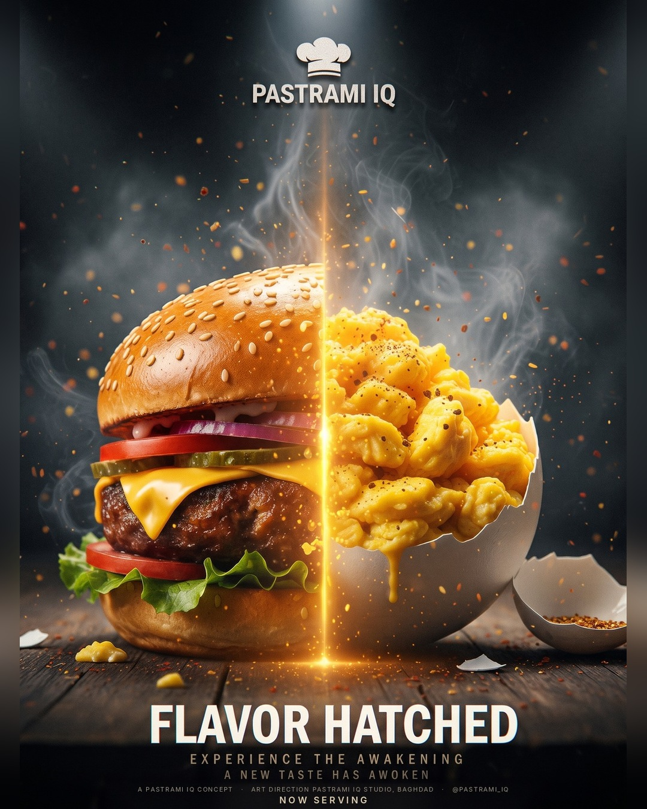 |
| *Down in one round.* | *Fried chicken, tailored stitch by stitch.* | *Breakfast pitched like a blockbuster. Now serving.* |

## Red hot

| The Heat Is On |
|:---:|
| [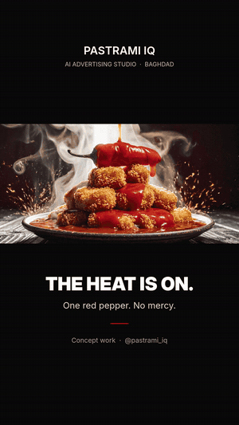](https://raw.githubusercontent.com/rabeea-global/pastrami-media/main/showcase/reel_heat.mp4) |
| *One red pepper. No mercy.* |

---

## The 72-hour concept sprint

1. **Hours 0–24 — brief to ten ideas.** Product, audience and occasion in; ten one-line concepts with rough frames out.
2. **Hours 24–48 — three in production.** You pick three; we build key visuals with clean, correctly spelled copy in English and Arabic.
3. **Hours 48–72 — final frames and a Reel.** Two rounds of changes, then 4:5 and 9:16 stills plus a short motion piece.

**For agencies:** white-label concept and AI production. You keep the client and the credit; we work to your brief and deadline.

**Sara** · PASTRAMI IQ · [@pastrami_iq](https://www.instagram.com/pastrami_iq/)

---
The `week1/`, `week2/` folders hold media files used for scheduled posts.
